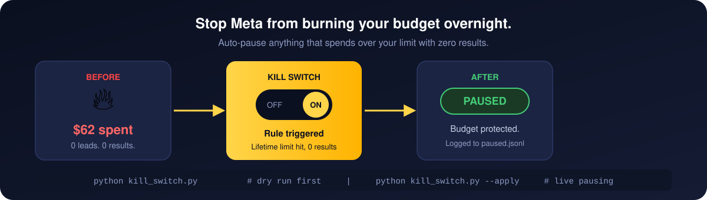
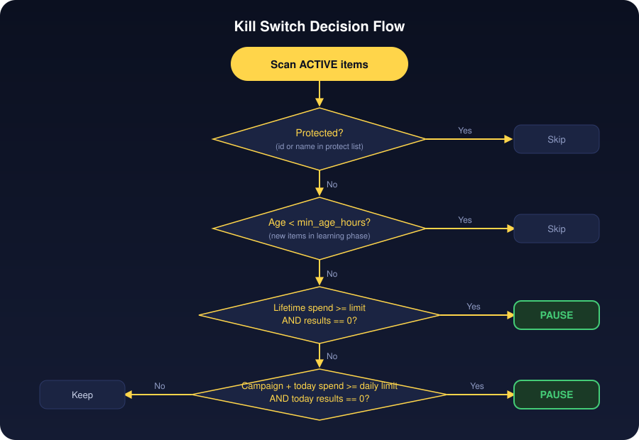
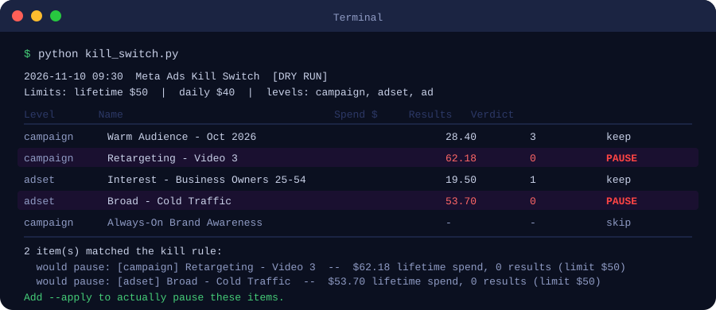
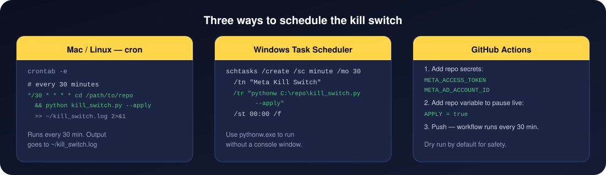
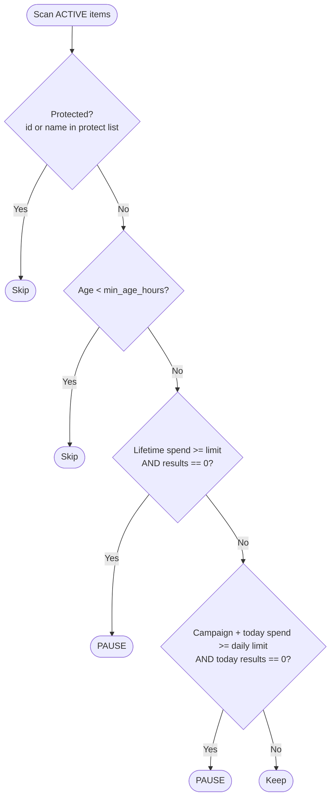

# Meta Ads Kill Switch

Stop Meta from burning your budget overnight. Auto-pause any ACTIVE ad, ad set, or campaign that hits your spend threshold with zero results.



Two rules run on every execution:

- **Lifetime rule:** anything with $50+ total spend and 0 results gets paused.
- **Daily rule:** campaigns with $40+ spend today and 0 results today get paused.

Both thresholds are configurable. Dry run by default. Add `--apply` to actually pause.

```bash
python kill_switch.py              # dry run, see what would be paused
python kill_switch.py --apply      # live: pause matching items and log them
```

---

## Why this exists

An ad set spent $62 in a single day with no leads. The campaign was optimizing for lead generation, but zero instant-form leads, zero pixel events. The budget kept running because nothing told it to stop.

Meta does have built-in automated rules. They work, but each rule has to be set up manually per campaign, and it is easy to miss one when you launch something new. This script runs on a schedule and covers everything in the account with a single config file.

---

## How the rule works



For every ACTIVE item in the account, the script:

1. Skips items on the protect list (by id or name substring).
2. Skips items younger than `min_age_hours` (so brand-new ads get a grace period during learning).
3. Checks lifetime spend vs. the lifetime limit. If over the limit with 0 results, the item is paused.
4. For campaigns only: checks today's spend vs. the daily limit. If over with 0 results today, the item is paused.

A "result" is any action type in your `result_action_types` list. The defaults are purchases and instant-form leads. See [Configuring result types](#configuring-result-types) for the lead double-count gotcha.

---

## Getting a Meta token

You need a System User token with `ads_management` and `ads_read` permissions.

1. In [Meta Business Settings](https://business.facebook.com/settings), go to **Users > System Users**.
2. Create a new System User (or use an existing one with admin access).
3. Click **Generate token**, select your app, and tick these permissions:
   - `ads_management`
   - `ads_read`
4. Copy the token. Store it in your `.env` file (never in code or git).

You also need your **ad account id**. It looks like `act_XXXXXXXXXXXXXXXX`. Find it in Ads Manager in the URL, or under **Business Settings > Ad Accounts**.

---

## Install

Python 3.10 or later.

```bash
git clone https://github.com/yousiful/meta-ads-kill-switch.git
cd meta-ads-kill-switch
pip install -r requirements.txt
```

Copy the example env file and add your credentials:

```bash
cp .env.example .env
```

Edit `.env`:

```
META_ACCESS_TOKEN=your_token_here
META_AD_ACCOUNT_ID=act_XXXXXXXXXXXXXXXX
```

---

## Dry run first

Always run without `--apply` before going live. The output shows a table of everything the script would touch, with spend and result counts.

```bash
python kill_switch.py
```



The table columns are:

| Column | What it shows |
|---|---|
| Level | campaign, adset, or ad |
| Name | The item name from Ads Manager |
| Spend $ | Lifetime spend in USD |
| Results | Total results using your configured action types |
| Verdict | keep, skip (protected or too new), or PAUSE |

Nothing is changed during a dry run. When the output looks right, add `--apply`.

---

## Going live

```bash
python kill_switch.py --apply
```

Matching items are paused via the Meta API. Every pause is logged to `paused.jsonl` with the item id, name, spend, reason, and timestamp. Use `undo.py` to reverse them.

---

## Config

Copy `config.example.json` to `config.json` and adjust the values. All keys are optional.

```json
{
  "lifetime_spend_limit": 50,
  "daily_spend_limit": 40,
  "levels": ["campaign", "adset", "ad"],
  "result_action_types": [
    "purchase",
    "offsite_conversion.fb_pixel_purchase",
    "onsite_conversion.lead_grouped"
  ],
  "protect": [
    "120250000000000000",
    "Always-On Brand"
  ],
  "min_age_hours": 4
}
```

| Key | Default | What it does |
|---|---|---|
| `lifetime_spend_limit` | 50 | Pause anything with more than this in lifetime spend and 0 results |
| `daily_spend_limit` | 40 | Pause campaigns with more than this in today's spend and 0 results today |
| `levels` | campaign, adset, ad | Which object levels to scan |
| `result_action_types` | see below | Action types that count as a result |
| `protect` | [] | Items whose id or name contains any of these strings are never paused |
| `min_age_hours` | 0 | Do not kill anything younger than this many hours |

### Configuring result types

The default result types cover purchase campaigns and instant-form lead campaigns:

```json
"result_action_types": [
  "purchase",
  "offsite_conversion.fb_pixel_purchase",
  "onsite_conversion.lead_grouped"
]
```

**Lead double-count warning.** Meta's `lead` action type adds two separate signals together: instant-form completions and pixel `Lead` events. If your campaign has both a lead form and a pixel firing `Lead`, Meta counts them twice. The fix is to use `onsite_conversion.lead_grouped` for instant-form leads only. Add `offsite_conversion.fb_pixel_lead` only if your pixel fires a `Lead` event and you want that signal to count as a result.

If your campaigns optimize for a custom conversion event (for example, an event named `OrderFormPurchase`), add it in scoped form:

```json
"offsite_conversion.fb_pixel_custom:OrderFormPurchase"
```

For call-booking campaigns:

```json
"schedule",
"offsite_conversion.fb_pixel_schedule"
```

---

## Scheduling



### Mac / Linux (cron)

```bash
crontab -e
```

Add this line (replace the path):

```
*/30 * * * * cd /path/to/meta-ads-kill-switch && python kill_switch.py --apply >> ~/kill_switch.log 2>&1
```

### Windows Task Scheduler

```bat
schtasks /create /sc minute /mo 30 ^
  /tn "Meta Kill Switch" ^
  /tr "pythonw C:\path\to\kill_switch.py --apply" ^
  /st 00:00 /f
```

Use `pythonw.exe` (not `python.exe`) to run without a console window. Set environment variables in the task's properties, or put them in a `.env` file in the same folder.

### GitHub Actions

Run it free on GitHub's servers, so your computer doesn't need to stay on. It checks every 30 minutes.

1. Fork this repo (or copy it into your own private repo).
2. Copy `examples/github-actions/kill-switch.yml` to `.github/workflows/kill-switch.yml` in your copy.
3. Add two **repository secrets** in Settings > Secrets and variables > Actions:
   - `META_ACCESS_TOKEN`
   - `META_AD_ACCOUNT_ID`
4. Dry run is on by default. To enable live pausing, add a **repository variable** (not a secret):
   - `APPLY` = `true`
5. Push. The workflow runs on the schedule.

You can also trigger it manually from the Actions tab with an `apply` input of `true` for a one-off run.

---

## Undo

Every applied pause is logged to `paused.jsonl`. To reverse recent pauses:

```bash
# Re-activate the most recent pause
python undo.py --last 1

# Re-activate the last 3 pauses
python undo.py --last 3

# Re-activate one specific item by Meta object id
python undo.py --id 120250000000000001

# See what would be re-activated without calling the API
python undo.py --dry-run --last 5
```

Undo only works for items where the pause was actually applied (not dry-run entries in the log).

---

## Notifications

Add `--notify-email` to send a summary email when items are found. Set SMTP credentials in `.env`:

```
SMTP_HOST=smtp.gmail.com
SMTP_PORT=587
SMTP_USER=you@example.com
SMTP_PASSWORD=your_app_password
NOTIFY_EMAIL=you@example.com
```

Add `--notify-webhook URL` to POST a summary to any webhook. The payload format is compatible with Slack, Discord, and Kenji inbound webhooks.

```bash
python kill_switch.py --apply --notify-email --notify-webhook https://hooks.example.com/xyz
```

---

## Decision flow



---

## FAQ

**What counts as a result?**
Whatever is in `result_action_types` in your config. The defaults are purchases and instant-form leads. If you run booking campaigns, add `schedule`. If you run awareness campaigns with no conversion goal, those items will never trigger the rule because they are not optimizing for a result, but you should probably not add them to the levels list either.

**Will this fire during the learning phase?**
Set `min_age_hours` to something like 48 to give new campaigns a grace period. Meta's learning phase typically needs 50 optimization events, which takes at least a day or two. The kill switch will not fire before `min_age_hours` have elapsed.

**How do I protect a campaign from being paused?**
Add its id or any part of its name to the `protect` list in config.json:

```json
"protect": ["Always-On Brand", "120250000000000000"]
```

The match is case-insensitive and checks whether the string appears anywhere in the name.

**Why not use Meta's built-in automated rules?**
Meta's automated rules do work. The difference is that each rule is scoped to specific campaigns and has to be set up manually every time you launch something new. It is easy to miss a campaign. This script reads the entire active account on every run with a single config file, so nothing falls through the gaps. If you are already using Meta's automated rules and they cover what you need, you do not need this.

**Can I run this on multiple ad accounts?**
Run separate instances with different `.env` files or override the env vars in your shell:

```bash
META_AD_ACCOUNT_ID=act_YYYYYYYY python kill_switch.py --apply
```

**The API returns a rate limit error.**
The script retries up to 6 times with backoff for error codes 4, 17, and 80004 (Meta's standard rate limit codes). If your account has a large number of active items, reduce the run frequency.

---

## Running the tests

```bash
python -m pytest tests/
# or without pytest:
python tests/test_rules.py
```

The tests cover the core decision logic with fake data. No network calls, no credentials needed.

---

## Want ads run for you and leads landing in your CRM?

We run Meta ads end-to-end and feed every lead directly into your CRM with automation built on top.

- **Sign up:** [freedom.kenjiai.com/finishhere](https://freedom.kenjiai.com/finishhere?utm_source=github&utm_medium=readme&utm_campaign=meta-ads-kill-switch)
- **Book a call:** [go.mediatraffics.com/leads](https://go.mediatraffics.com/leads?utm_source=github&utm_medium=readme&utm_campaign=meta-ads-kill-switch)
- **Learn more:** [kenjiai.com](https://kenjiai.com/?utm_source=github&utm_medium=readme&utm_campaign=meta-ads-kill-switch)

---

## More free tools from us

- **[Kenji Clip Engine](https://github.com/yousiful/kenji-clip-engine)**: turn any YouTube video into captioned vertical clips and post them everywhere through Kenji.
- **[No-Website Finder](https://github.com/yousiful/no-website-finder)**: find local businesses on Google Maps with no website and push them into Kenji to pitch.
- **[Reel Editing Toolkit](https://github.com/yousiful/reel-editing-toolkit)**: our full animated reel pipeline.

## Feedback and bugs

Something broke, or you want a feature? **[Open an issue](https://github.com/yousiful/meta-ads-kill-switch/issues/new/choose)**. We read every one and fix what we can. If this saved you time, a star helps other people find it.

MIT License.
